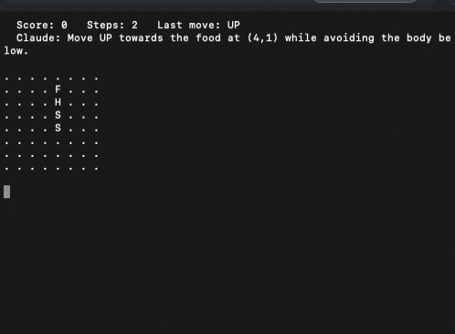

# AI Game Tester — Claude plays Snake

[](https://github.com/msuranek/ai-game-tester/actions/workflows/ci.yml)
[](https://www.python.org/downloads/)
[](LICENSE)

Ukázkový projekt: LLM agent (Claude Haiku) hraje hada v terminálu a rozhoduje každý tah na základě ASCII reprezentace hrací plochy.



---

## Jak to funguje

Každý tah projde touto smyčkou:

```
herní stav → ASCII board → Claude API → reasoning + tah → herní stav → ...
```

Claude dostane tuto hrací plochu:

```
. . . . . . . . . . . .
. . . F . . . . . . . .
. . . . . . . . . . . .
. . . . . H S S . . . .
. . . . . . . . . . . .
```

A odpoví ve formátu:

```
REASON: Food is above and to the left, moving up avoids body collision
MOVE: UP
```

Žádné hardcoded pravidla, žádný minimax — LLM rozhoduje v přirozeném jazyce na základě vizuálního kontextu.

---

## Instalace

```bash
git clone https://github.com/msuranek/ai-game-tester.git
cd ai-game-tester

python3 -m venv .venv
source .venv/bin/activate      # Windows: .venv\Scripts\activate

pip install -r requirements.txt
```

Přidej API klíč do `.env`:

```bash
cp .env.example .env
# vlož svůj ANTHROPIC_API_KEY
```

Klíč získáš na [console.anthropic.com](https://console.anthropic.com).

---

## Spuštění

### Živá hra

```bash
python main.py
```

Claude hraje hada v reálném čase. Výchozí nastavení: 8×8 plocha, 0.3s mezi tahy.

### Zobrazit reasoning

```bash
python main.py --verbose
```

Pod hrací plochou uvidíš co si Claude myslí před každým tahem:

```
  Score: 3   Steps: 47   Last move: LEFT
  Claude: Food is directly above, moving up would hit the wall — go left instead
```

### Benchmark — testování výkonu

```bash
python main.py --benchmark 10
```

Spustí 10 her za sebou bez display a vypíše statistiky. Každá tečka = jeden tah Claude:

```
Running 10 games on 8x8 board...

  Game   1: ..........................................  score=4  steps=42  status=game_over  time=36.5s
  Game   2: ....................  score=2  steps=20  status=game_over  time=17.1s
  Game   3: ....................................................................  score=6  steps=68  status=game_over  time=58.3s
  ...

========================================
  Games played : 10
  Avg score    : 3.80
  Best score   : 6
  Worst score  : 1
  Avg steps    : 97
========================================
```

> **Pozor:** každý tah volá Claude API (~0.5–1s). Na větší ploše had přežívá déle → více callů → vyšší cena. Výchozí 8×8 je rozumný kompromis. Pro rychlé testování: `--benchmark 3`.

Právě tady se projekt stává nástrojem pro testování — můžeš měřit jak změny promptu ovlivní výkon agenta.

Pro opakovatelné experimenty nastav seed a výsledky ulož do JSON nebo CSV:

```bash
python main.py --benchmark 10 --seed 42 --output results.json
python main.py --benchmark 10 --seed 42 --max-steps 500 --output results.csv
```

Jiný model nebo prompt lze otestovat bez zásahu do kódu:

```bash
python main.py --benchmark 10 --seed 42 --model MODEL_ID
python main.py --benchmark 10 --seed 42 --prompt-file prompts/experiment.txt
```

Při porovnávání variant použij stejný seed a počet her. Jednotlivé hry pak dostanou po sobě jdoucí seedy (`42`, `43`, …), takže začnou se stejnými náhodnými podmínkami.

Benchmark má bezpečnostní limit 1 000 tahů na hru, aby cyklus agenta neutratil neomezený počet API volání. Změníš ho přes `--max-steps`.

### Další volby

```bash
python main.py --size 12          # větší plocha (více tahů = více API callů)
python main.py --size 6           # menší plocha, rychlejší hry
python main.py --delay 0.1        # rychlejší animace
python main.py --no-display       # headless, jen výsledné skóre
python main.py --benchmark 5      # 5 her, výchozí 8×8
python main.py --benchmark 5 --seed 42 --output results.json
```

---

## Struktura projektu

```
ai-game-tester/
  game/
    snake.py          # čistá herní logika — žádný display, jen stav
  agent/
    claude_agent.py   # volá Claude API a parsuje odpověď
  main.py             # game loop, terminálový výstup, benchmark
  requirements.txt
  tests/              # testy herní logiky, parseru a benchmarku
  .env.example
```

### `game/snake.py`

Čistá herní logika bez jakékoli závislosti na AI nebo display. Implementuje:

- pohyb hada, kolize, sbírání jídla
- `render()` → ASCII string pro Claude
- `valid_moves()` → seznam tahů které hada okamžitě nezabijí

Lze vyměnit za libovolnou jinou hru — stačí implementovat stejné rozhraní.

### `agent/claude_agent.py`

Volá `claude-haiku-4-5` přes Anthropic SDK. Haiku je záměrná volba — je rychlé a levné pro herní smyčku. Model dostane ASCII board a vrátí reasoning + tah.

### `main.py`

Spojuje hru s agentem. Tři režimy: živá hra, headless, benchmark.

---

## Cena

Model `claude-haiku-4-5` je velmi levný. Následující původní orientační odhady platí **k 1. 5. 2026**, tedy k datu prvního commitu projektu, pro model `claude-haiku-4-5-20251001`:

| Režim | Tahy | Odhadovaná cena |
|-------|------|-----------------|
| 1 hra | ~50–200 tahů | < $0.001 |
| benchmark 10 her | ~500–2000 tahů | < $0.01 |
| benchmark 100 her | ~5000–20000 tahů | < $0.10 |

Aktuální ceny se mohou lišit; před větším během zkontroluj [oficiální ceník Anthropic](https://www.anthropic.com/pricing#api).

---

## Vývoj a testy

```bash
pip install -r dev-requirements.txt
ruff check .
pytest
```

Testy pokrývají pohyb hada, kolize, sbírání jídla, `valid_moves()`, parser odpovědi modelu, bezpečný fallback a export benchmarku. GitHub Actions je spouští spolu s lintem na Pythonu 3.11, 3.12 a 3.13.

---

## Kam dál

Projekt je záměrně jednoduchý — základ pro vlastní experimenty:

- **Vyměň agenta**: místo Claude zkus GPT-4o, Gemini, nebo deterministický minimax
- **Vyměň hru**: Snake → 2048, Minesweeper, nebo vlastní hra
- **Prompt engineering**: jak moc změní skóre úprava system promptu?
- **Logging**: ulož každý tah do JSON a analyzuj kde agent chybuje

---

Projekt vznikl jako demonstrace k článku [Nechte AI hrát moji hru](https://aidevelopers.cz/clanky/2026-04-29-nechte-ai-hrat-moji-hru-budovani-testovaciho-prostredi-pro-p) na [aidevelopers.cz](https://aidevelopers.cz).

## Licence

[MIT](LICENSE)
